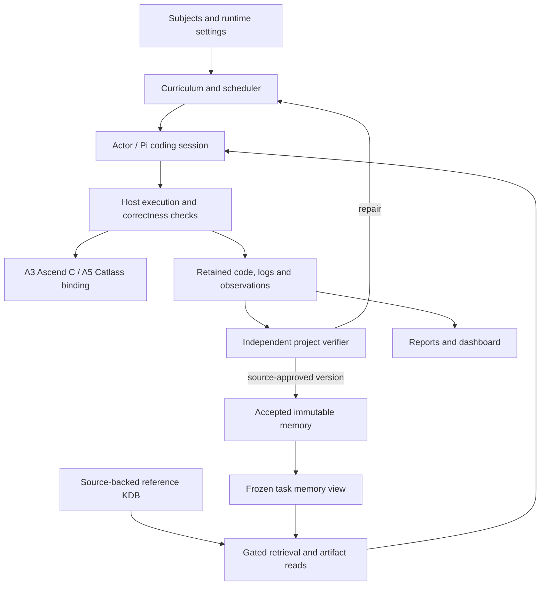

<p align="center">
  
</p>

<h1 align="center">
  
</h1>

<h2 align="center">
  <picture>
    <source media="(max-width: 600px)" srcset="docs/assets/rsiagent-subtitle-mobile.svg">
    
  </picture>
</h2>

<p align="center">
  <a href="https://arxiv.org/pdf/2609.15364"></a>
  <a href="https://huggingface.co/papers/2609.15364" title="No. 6 on the September 15, 2026 Daily Papers list; checked September 16, 2026 (UTC)"></a>
  <a href="https://aetherlabsai.github.io/RSIAgent/"></a>
  <a href="LICENSE"></a>
</p>

<p align="center">
  <a href="#workflows">Workflows</a> · <a href="#architecture">Architecture</a> · <a href="#quickstart">Quickstart</a> · <a href="#interfaces">Interfaces</a> · <a href="#operations">Operations</a> · <a href="#results">Results</a> · <a href="#documentation">Documentation</a>
</p>

RSIAgent develops reusable experience through **execution, independent verification,
and persistent memory**. A Curriculum Agent selects work, an Actor carries it out,
and verification grounds what is learned. The recursive-improvement workflows keep
model weights fixed; learning changes the memory supplied to subsequent tasks.

This repository supports Ascend kernel learning and optimization alongside the
OSWorld and Agents' Last Exam desktop integrations. The current Ascend workflow
uses an ordered subject curriculum that combines exploration, repair, qualified
targets and optimizer tasks in one run.

## Workflows

| Goal | Entry point | Guide |
| --- | --- | --- |
| Learn Ascend capabilities across ordered subjects | `python run_ascend_subjects.py run` | [Subject curriculum](docs/subject-curriculum.md) |
| Optimize a submitted Torch computation on A3 | `python -m optimizer` plus `python -m optimizer.worker` | [Optimizer jobs](docs/optimizer.md) |
| Inspect campaigns and retained evidence | `python -m dashboard serve` | [Dashboard](dashboard/README.md) |
| Run OSWorld baseline and RSI batches | `python run_osworld.py` | [Desktop setup](docs/desktop-quickstart.md) · [Operations](docs/OPERATIONS.md) |
| Prepare, run and report ALE batches | `python run_ale.py` | [ALE](docs/ALE.md) |

### Ascend subject curriculum

Subjects describe capabilities to develop, such as data movement, arithmetic,
reductions and optimization. The curriculum chooses projects and revisits earlier
subjects when accepted memory lacks coverage. Each wave uses a frozen memory view.
An Actor writes and repairs code through the production Pi coding runtime; the
host owns compilation, execution, numerical checks, timing and profiling.

An independent project verifier reads source and retained execution evidence,
can request additional host checks, and can send even a numerically passing
project back for repair. Source-approved reusable memories publish immediately as
immutable KDB versions, with their supporting code and evidence. There is no
separate memory A/B admission experiment.

Subjects can also carry a host-qualified target or an optimizer task. These reuse
their existing correctness contracts. See [subject configuration and memory
publication](docs/subject-curriculum.md) for the complete workflow and defaults.

| Target binding | Implemented execution |
| --- | --- |
| A3 / Ascend C | Graph learning, qualified targets and Ascend C optimizer subjects |
| A5 / Catlass DSL | Graph learning and qualified graph/performance targets through the Catlass binding |

The optimizer backend emits Ascend C; A5 Catlass optimizer subjects are rejected.
A3 validation does not establish A5 correctness, compiler compatibility or timing.
Product, compiler, CANN, dependency revisions and selected devices belong to the
observed runtime configuration, rather than being inferred from a target name.

Ascend campaigns use `run_ascend_subjects.py`. Phase 2 execution, historical
readers, controllers and compatibility commands have been removed. The existing
Phase 1 launcher remains available for standalone exploration; it does not start
another stage.

### Standalone kernel optimization

Submit a Python function or module and representative input signatures. Reference
preparation generates deterministic cases, checks reproducibility and freezes
inputs, outputs, state and comparison policy before candidates run. The optimizer
Actor proposes Ascend C implementations against that frozen suite.

Every case must pass host correctness checks before candidate timing. The loop
scores verified candidates against retained Torch timings over the entire suite;
a slower correct kernel remains a valid result. Requested profiling is a separate
diagnostic replay and does not establish correctness or replace ordinary timing.
Jobs retain submissions, source revisions, events, artifacts and execution handles
independently of the dashboard.

## Architecture



The host distinguishes four questions: did execution complete, was the output
correct, how did it perform, and did the proposed memory help? A model's claim or
a completed process answers none of the other questions by itself. Retained
observations, independent verification and source-review decisions determine the
corresponding outcomes.

| Layer | Responsibility | Main implementation |
| --- | --- | --- |
| Orchestration | Subject selection, waves, repair, memory publication and elapsed budgets | `benchmarks/ascend/` |
| Agent runtime | Pi coding sessions, typed host actions, bounded context and provider gateway | `coding/pi/`, `integrations/pi/` |
| Workload/reference | Deterministic cases, frozen reference bundles and comparison policy | `optimizer/cases.py`, `optimizer/reference.py` |
| Execution | Target-specific compilation, launch, correctness checks and measurements | Ascend target bindings, `optimizer/native.py`, `optimizer/measurement.py` |
| Knowledge and memory | Citation-gated source retrieval, immutable learned versions and artifact access | Knowledge agents and subject memory |
| Observation | Durable events, reports, artifact collection and dashboard | Campaign records, job store, `dashboard/` |

The standalone optimizer has its own backend-neutral loop. Its backend exposes
`prepare`, `evaluate` and `profile`; the worker owns runtime selection, process
lifetime, transport and retained-operation recovery. This separates a proposal
from execution and a measurement from its interpretation.

The desktop framework shares the Curriculum/Actor/Verifier strategy but retains
its own VM lifecycle and official evaluation fence. Phase 1 broad exploration
feeds its authenticated frozen memory directly to Phase 3 evaluation. Baseline
execution runs without learning. Stage numbers remain 1 and 3; there is no
intermediate target-practice stage. See [desktop architecture](docs/ARCHITECTURE.md).
Official benchmark scores stay outside the learning loop.

## Quickstart

Choose a workflow before installing device or VM dependencies. Paths below are
placeholders for your own ignored configuration and output directories. Run
commands from this checkout unless another directory is shown.

### Ascend host setup

```bash
git clone https://github.com/mdrumond/RSIAgent.git
cd RSIAgent
python3 -m venv .venv
source .venv/bin/activate
python -m pip install -r requirements.txt
npm ci --prefix integrations/pi
```

Pi requires Node 22 or newer. Install and activate the selected Ascend runtime
separately. Keep model credentials in environment variables or a private environment
file; runtime/workspace paths and device selection belong in ignored JSON settings.
The host dependencies do not install CANN, Torch-NPU, Catlass or model weights.
See [Pi setup](docs/PI_CODING_RUNTIME.md) and
[target/runtime configuration](docs/ascend-target-launcher.md).

There are separate configuration concerns:

| Configuration | Owns |
| --- | --- |
| Subject file | Ordered subject IDs, objectives, minimum waves and optional target/optimizer tasks |
| Campaign settings | Models, existing `phase1_arguments`, optional KDB, verifier and memory-publication settings |
| Execution settings | Local/remote mode, observed runtime/toolchain, workspace and physical device; compatible optimizer worker settings when used |
| Provider environment | Credentials supplied outside source control and published artifacts |

For local execution, use `execution: "local"` in the shared worker configuration
and activate the intended Python/CANN environment before launch. Kernel work runs
in local child processes; it still requires real hardware and the matching
compiler/runtime. For remote execution, use the configured `remote-access`
registry and runtime. Discover capabilities, preflight and check device health
before dispatch; transport availability alone does not qualify a runtime. Retain
returned operation handles and observe them after disconnects.

Start with a bounded configured smoke, rather than a full campaign:

```bash
python -m benchmarks.pi_coding.smoke --worker-config /private/worker.json \
  --root /private/pi-smoke --window initial-check --max-seconds 1200 --check-only
```

`--check-only` does not run the model workload. Remove it only after preparing the
matching execution environment and programming guide. See
[local execution](docs/local-kernel-execution.md) and the smaller
[local add-one optimizer smoke](docs/optimizer-local-smoke.md).

### Run a subject curriculum

Copy [the example subjects](config/examples/subjects.json) into private
configuration and edit the objectives. Prepare runtime settings using the
[subject guide](docs/subject-curriculum.md).

```bash
python run_ascend_subjects.py run --target a3 --root /private/subject-run \
  --subjects /private/subjects.json --config /private/settings.json \
  --initial-memory /private/seed.txt --max-seconds 7200
python run_ascend_subjects.py report --root /private/subject-run
python run_ascend_subjects.py resume --target a3 --root /private/subject-run \
  --subjects /private/subjects.json --config /private/settings.json \
  --initial-memory /private/seed.txt --max-seconds 7200
```

Run one controller per root. Resume preserves the frozen subjects, settings,
completed work and elapsed allocation; it does not grant another two hours.
Use a fresh root for a different experiment identity. A5 selects `--target a5`
with its independently prepared Catlass configuration.

### Create and execute an optimizer job

Prepare a reference source, signature JSON and eligible memory source as described
in [optimizer jobs](docs/optimizer.md). For example, `signatures.json` may contain:

```json
{"signatures": [{"args": [{"shape": [257], "dtype": "float32"}]}]}
```

```bash
python -m optimizer create --store /private/jobs --source reference.py \
  --entrypoint forward --signature signatures.json \
  --memory-root /private/eligible-memory --name example --max-seconds 1200
python -m optimizer.worker --root /private/jobs --job-id JOB_ID \
  --config /private/optimizer-worker.json
python -m optimizer inspect --store /private/jobs JOB_ID
```

Creation stores a job; the worker executes it. Memory discovery reports ineligible
or unavailable sources rather than assuming any directory is reusable memory.
The dashboard can also create jobs when its independent optimizer controls are
configured. See [worker configuration](docs/optimizer-worker.md).

### Desktop benchmarks

OSWorld and ALE require a Linux host with Docker/KVM and separately prepared
benchmark assets. OSWorld uses its pinned August 8, 2026 release; ALE uses
`d10fb61a14f9719774c3520c5763068b28ef5546`. Install their environments and run
per-OS VM smokes before execution. Full setup is in
[desktop quickstart](docs/desktop-quickstart.md) and [ALE setup](docs/ALE.md).

```bash
python run_osworld.py --arm both --name osworld_run_01 --dry-run
python run_osworld.py --arm both --name osworld_run_01 --concurrency 1
```

```bash
../agents-last-exam/.venv/bin/python run_ale.py plan --arm both
../agents-last-exam/.venv/bin/python run_ale.py run \
  --arm both --output results/ale/run_01 --concurrency 1
../agents-last-exam/.venv/bin/python run_ale.py report \
  --runs results/ale/run_01 --output results/ale/report_01
```

Use `baseline` for execution without RSI, `rsi` for Phase 1 learning followed
directly by Phase 3 frozen-memory evaluation, or `both`. OSWorld protocols use
schema version 2; ALE protocols, manifests and workers use version 3. Older
three-stage inputs are rejected before execution. Use a fresh batch name/output
directory; no historical Phase 2 migration or reporting interface remains.
Begin with one task lineage and increase concurrency only when the VM host has
capacity.

## Interfaces

| Interface | Contract |
| --- | --- |
| `run_ascend_subjects.py run/resume/report` | Current Ascend subject lifecycle; report reads retained state without model/device work |
| `optimizer.reference.prepare_reference` / `freeze_reference` | Prepare reproducible Torch workloads and retain their exact baseline bundle |
| `optimizer.reference.load_reference` / `validate_reference` | Authenticate frozen bundles and validate retained workload integrity; existing native entrypoints remain compatible |
| `OptimizationLoop` backend `prepare/evaluate/profile` | Frozen suite preparation, factual candidate evaluation and separate diagnostics; retained operations must be idempotent |
| `SubjectExecutor` | Graph and optimizer execution adapters returning host observations and artifact references |
| Project verifier and memory publication | Independent source/outcome review, repair requests and accepted-version publication |
| KnowledgeAgent and artifact readers | Selected-collection, citation-validated retrieval and admitted evidence reads |
| `python -m optimizer` | Job discovery, creation, inspection, events, stop and explicit budget extension |

Reference source is trusted workload code executed inside an isolated worker,
not sandboxed Python. The host chooses the cases and comparison policy; candidate
source cannot redefine correctness. See [reference contracts](docs/optimizer-reference.md),
[native ABI](docs/optimizer-native.md) and [backend contract](optimizer/LOOP.md).

## Operations

### Budgets, stop and resume

Ascend runtime stopping budgets use elapsed seconds. Compilation, model calls,
verification and nested work consume the enclosing allocation; resume preserves
time already spent. Attempts, tool calls, tokens and spend are telemetry, while
frozen case bounds and per-request limits remain enforced.

Optimizer lifecycle controls are explicit:

```bash
python -m optimizer events --store /private/jobs JOB_ID
python -m optimizer stop --store /private/jobs JOB_ID
python -m optimizer resume --store /private/jobs JOB_ID --additional-seconds 600
```

A worker owns cancellation and terminal acknowledgement. An interrupted or
unobservable remote operation remains uncertain until its retained handle is
settled; a new process is not permission to duplicate it. The subject CLI exposes
`run`, `resume` and `report`, rather than the optimizer's stop/budget-extension
interface. Preserve pending evidence and use the same root when recovering.

### Knowledge, memory and evidence

The reference KDB and learned memory serve different purposes. The KDB supplies
pinned source/document citations; learned memory supplies experience admitted
from verified work. With KDB enabled, accepted memory versions have indexed
collections and Actors retrieve against their frozen active-version view.
Drafts do not enter ordinary accepted-memory retrieval. Source-approved lessons
publish directly; no separate A/B admission experiment runs. Memory usage is
recorded against immutable versions. Evidence from ordinary verified projects can
challenge an existing lesson and drive source-reviewed correction or replacement;
an in-progress Actor keeps its frozen view. Reference-exposed benchmark material
must remain labeled as such.

Inspect `subject-campaign.json`, project outcomes, accepted
memory and their content-addressed evidence together. Optimizer jobs retain
immutable submissions, event chains, source and operation results. Missing metrics
and unavailable diagnostics are explicit. Budget exhaustion does not erase an earlier correct candidate or prove useful memory.
Full profiler trees may remain on the execution host; compact records point to
retained evidence rather than inventing missing reports.

### Dashboard

```bash
python -m pip install -r dashboard/requirements.txt
python -m dashboard serve --config /private/dashboard.json \
  --cache-dir /private/dashboard-cache
```

The default listener is `http://127.0.0.1:8080`. Configure locally accessible
campaign roots using [the example](dashboard/config.example.json). The viewer
shows supported subject campaigns, standalone exploration and optimizer jobs,
source, traces, host verification, memory decisions and timing/profiling evidence. Unavailable data
stays unavailable; cached snapshots are labeled stale when needed.

Campaign controls are disabled by default; the optimizer has its own independent
configuration. Use the [dashboard guide](dashboard/README.md) for supported controls and loopback
requirements. A page refresh does not launch a replacement worker.

### Validation

Portable release checks need no model credentials or benchmark VM:

```bash
uv venv .venv --python 3.12
uv pip install --python .venv/bin/python -r requirements-dev.txt
.venv/bin/python tools/check_rsi_release.py
```

VM smokes validate runtime mechanics with synthetic files, not benchmark scores.
CPU regressions and source references do not establish NPU correctness or
performance. Real device claims require the matching runtime, toolchain,
correctness cases and measurement conditions. See
[measurement semantics](docs/optimizer-measurement.md) and
[release validation](docs/RELEASE.md).

## Results

The manuscript reports these mean partial-credit scores (%):

| Benchmark and reporting coverage | RSIAgent without RSI | RSIAgent |
| --- | ---: | ---: |
| OSWorld 2.0 · 0808 offline · 82 tasks | 71.97 | **78.98** |
| Agents' Last Exam · Near-term · 67 tasks | 83.75 | **84.82** |

These are manuscript aggregates from the original method, not measurements of
the current Ascend or direct exploration-to-evaluation desktop workflows.
The RSI column uses 41 recorded OSWorld entries and 19 ALE entries, retaining
baseline scores for the remaining 41 and 48 tasks respectively. ALE includes all
67 Near-term tasks, including three completed GPU baselines. Selected retries and
checkpoints use differing budgets; these are not matched repeated-run averages.
ALE also includes qualified local regrades and protocol variants. See
[paper and reporting notes](docs/PAPER.md) for full coverage, metrics and caveats.
The public OSWorld batch contains 108 tasks, distinct from the manuscript's
82-task reporting coverage.

The paper studies broad exploration, targeted deep practice and test-time reuse
of frozen memory. View the [original framework figure](docs/assets/framework.png),
[overview video](https://github.com/user-attachments/assets/11cb3919-1073-4ba3-8bcd-37a15ec53c33)
and [demo](https://github.com/user-attachments/assets/b939a9c2-4acb-4c30-b72e-18bab646529c).
Figure and reporting provenance are documented in the [paper guide](docs/PAPER.md).

## Documentation

| Topic | Guide |
| --- | --- |
| Current Ascend learning and memory publication | [Subject curriculum](docs/subject-curriculum.md) |
| Standalone Ascend exploration | [Phase 1 launcher](docs/ascend-campaigns.md) |
| Runtime and coding setup | [Local execution](docs/local-kernel-execution.md) · [Pi](docs/PI_CODING_RUNTIME.md) · [Target configuration](docs/ascend-target-launcher.md) |
| Optimizer contracts | [Jobs](docs/optimizer.md) · [Reference](docs/optimizer-reference.md) · [Native ABI](docs/optimizer-native.md) · [Worker](docs/optimizer-worker.md) |
| Knowledge retrieval | [Expanded reference KDB](docs/expanded-kdb.md) · [Adaptive librarian](docs/knowledge/adaptive-librarian.md) |
| Evidence and observation | [Optimizer artifacts](docs/OPTIMIZER_ARTIFACTS.md) · [Dashboard](dashboard/README.md) |
| Desktop integration | [Quickstart](docs/desktop-quickstart.md) · [Architecture](docs/ARCHITECTURE.md) · [OSWorld operations](docs/OPERATIONS.md) · [ALE](docs/ALE.md) |
| Research and development | [Paper](docs/PAPER.md) · [Contributing](docs/CONTRIBUTING.md) · [Third-party attribution](docs/THIRD_PARTY.md) |

## Citation

If you use RSIAgent, please cite the [arXiv preprint](https://arxiv.org/abs/2609.15364):

```bibtex
@misc{zhu2026rsiagentautonomousexplorationrecursive,
      title={RSIAgent: Autonomous Exploration for Recursive Self-improvement in New Environments},
      author={Sibo Zhu and Shicheng Fan and Xinyue Wang and Wenyi Wu and Kun Zhou and Biwei Huang},
      year={2026},
      eprint={2609.15364},
      archivePrefix={arXiv},
      primaryClass={cs.AI},
      url={https://arxiv.org/abs/2609.15364},
}
```

## License

RSIAgent is licensed under [Apache 2.0](LICENSE). Third-party dependencies and
benchmark assets retain their respective licenses and terms; see
[third-party attribution](docs/THIRD_PARTY.md).
